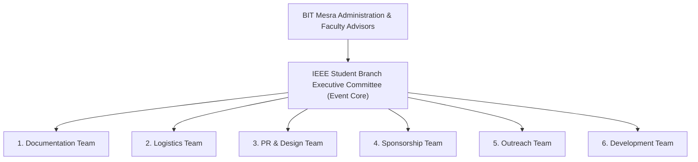

# About the Organizers: BIT Mesra & IEEE Student Branch

## 1. Overview
This section profiles the two organizing bodies behind Cicada CTF 2026: **Birla Institute of Technology (BIT), Mesra** and the **IEEE Student Branch of BIT Mesra**. It documents the institutional governance, faculty leadership, and student organizational structure overseeing the event.

## 2. Responsible Team and Members
- **Primary Owner:** Documentation Team
- **Key Contributors:** IEEE Student Branch Executive Committee, Faculty Coordinators
> ⚠️ TBD: Confirm names of Faculty Advisors, Head of Department(s), Dean of Student Affairs, and IEEE Student Branch Office Bearers | Owner: Documentation Team | Due: 2026-11-10

## 3. Timeline
| Milestone | Target Date | Status |
| :--- | :--- | :--- |
| Institutional Approval & Charter Sign-off | `TBD` | Pending |
| Organizing Committee Formation | `TBD` | Pending |
| Official Boilerplate Approval for Sponsors | `TBD` | Pending |

## 4. Detailed Description
### 4.1 Birla Institute of Technology (BIT), Mesra
Birla Institute of Technology, Mesra (Ranchi, Jharkhand, India), established in 1955 by philanthropist and industrialist Mr. B. M. Birla, is one of India's premier technical and research universities. With a strong legacy in computer science, engineering, and technological innovation, BIT Mesra actively supports student-led technical initiatives, research symposia, and national-level competitions.

> ⚠️ TBD: Insert approved institutional description and messages from BIT Mesra Leadership / Faculty Patron | Owner: Documentation Team | Due: 2026-11-15

### 4.2 IEEE Student Branch, BIT Mesra
The **IEEE Student Branch of BIT Mesra** is an active student chapter affiliated with the Institute of Electrical and Electronics Engineers (IEEE). The club conducts technical workshops, hackathons, coding competitions, guest lectures, and research initiatives aimed at advancing technology and engineering excellence among students.

> ⚠️ TBD: Insert official IEEE Student Branch BIT Mesra history, Region/Section affiliation details, and current executive leadership roster | Owner: Documentation Team | Due: 2026-11-12

### 4.3 Organizational Governance Structure (`Cicada CTF 2026`)
The event is executed through six specialized functional teams operating under the supervision of the IEEE Student Branch Executive Committee and BIT Mesra Faculty Coordinators:

## 5. Decisions Made and Why
- **Decision:** Structure the organizing committee into six dedicated functional teams (Documentation, Logistics, PR & Design, Sponsorship, Outreach, and Development).
- **Rationale:** Clear separation of concerns prevents bottlenecks between platform engineering (Development), physical/event execution (Logistics), external partnerships (Sponsorship/Outreach/PR), and institutional reporting (Documentation).

## 6. Challenges Faced and How They Were Solved
> ⚠️ TBD: Document cross-team coordination challenges and administrative approval workflows | Owner: Documentation Team | Due: Post-Event

## 7. Outcomes and Metrics
| Metric | Value |
| :--- | :--- |
| Total Organizing Teams | 6 (Documentation, Logistics, PR & Design, Sponsorship, Outreach, Development) |
| Total Organizing Committee Members | `TBD` |
| Total Student Volunteers | `TBD` |
| Faculty Advisors Involved | `TBD` |

## 8. Photo/Media Section

*Figure 0.3: Cicada CTF 2026 Organizing Committee from IEEE Student Branch BIT Mesra with Faculty Advisors | Date: TBD | Photo credit: TBD*

## 9. Lessons Learned
> ⚠️ TBD: Capture insights on governance and inter-team communication for future IEEE BIT Mesra committees | Owner: Documentation Team | Due: Post-Event

## 10. Open Items / TBD
> ⚠️ TBD: Obtain official faculty advisor names, designations, and forewords | Owner: Documentation Team | Due: 2026-11-15
> ⚠️ TBD: Confirm IEEE Student Branch Counselor and Executive Committee names | Owner: Documentation Team | Due: 2026-11-10
> ⚠️ TBD: Confirm total member count across all six organizing teams | Owner: Documentation Team | Due: 2026-11-10
