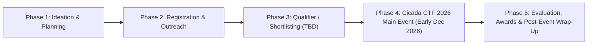

# About the Event: Cicada CTF 2026

## 1. Overview
This section introduces **Cicada CTF 2026**, outlining its vision, objectives, competition structure, target audience, and significance within the cybersecurity ecosystem at BIT Mesra and across participating institutions. It provides external readers, sponsors, and future organizers with a high-level understanding of the event's scope and value proposition.

## 2. Responsible Team and Members
- **Primary Owner:** Documentation Team
- **Key Contributors:** Core Organizing Committee, Development Team, Outreach Team
> ⚠️ TBD: List specific authors and core committee leads responsible for the event charter | Owner: Documentation Team | Due: 2026-11-08

## 3. Timeline
| Milestone | Target Date | Status |
| :--- | :--- | :--- |
| Event Charter & Theme Finalization | `TBD` | Pending |
| Date & Mode Confirmation (Early Dec 2026) | `TBD` | Pending |
| Public Event Announcement | `TBD` | Pending |
| Main Competition Dates | Early December 2026 (`TBD`) | Planned |

## 4. Detailed Description
### 4.1 Event Vision & Purpose
**Cicada CTF 2026** is a premier Capture The Flag (CTF) cybersecurity competition jointly organized by **BIT Mesra** and the **IEEE Student Branch of BIT Mesra**, scheduled for **early December 2026**. The event is designed to test and cultivate practical offensive and defensive security skills among students through hands-on problem solving across multiple cybersecurity domains.

### 4.2 Core Objectives
1. **Skill Development:** Provide a realistic, sandboxed environment where participants solve real-world security challenges in Web Exploitation, Cryptography, Binary Exploitation (Pwn), Reverse Engineering, Digital Forensics, Open-Source Intelligence (OSINT), and Miscellaneous security domains.
2. **Community Building:** Foster an active cybersecurity research and competitive hacking community at BIT Mesra and partner institutions.
3. **Industry Alignment:** Bridge academic computer science concepts with practical industry cybersecurity challenges, connecting top talent with sponsors and industry mentors.

### 4.3 Event Format Overview
- **Scheduled Window:** Early December 2026 (`Exact Dates: TBD`)
- **Mode of Execution:** `TBD (Online / Offline / Hybrid)`
- **Venue:** `TBD`
- **Duration:** `TBD (e.g., 24-hour / 36-hour / multi-round format)`
- **Competition Style:** `TBD (Jeopardy-style / Attack-Defense / Hybrid)`

## 5. Decisions Made and Why
> ⚠️ TBD: Document core decisions regarding competition mode (Online/Offline/Hybrid), duration, and whether a qualifier round precedes the finals | Owner: Core Committee & Development Team | Due: 2026-11-12

## 6. Challenges Faced and How They Were Solved
> ⚠️ TBD: Record strategic challenges in scoping the event calendar around academic schedules in early December 2026 | Owner: Logistics Team & Documentation Team | Due: 2026-11-20

## 7. Outcomes and Metrics
| Metric | Target | Actual (Post-Event) |
| :--- | :--- | :--- |
| Total Registered Participants | `TBD` | `TBD` |
| Total Registered Teams | `TBD` | `TBD` |
| Participating Colleges / Institutions | `TBD` | `TBD` |
| Total Challenges Deployed | `TBD` | `TBD` |
| Total Flag Submissions | `TBD` | `TBD` |
| Total Prize Pool | `TBD` | `TBD` |

> ⚠️ TBD: Populate target KPIs before the event and actual metrics post-event | Owner: Outreach Team & Development Team | Due: Pre-Event (2026-11-15) / Post-Event

## 8. Photo/Media Section

*Figure 0.2: Cicada CTF 2026 Key Highlights and Format Overview | Date: TBD | Photo credit: TBD*

## 9. Lessons Learned
> ⚠️ TBD: Summarize high-level lessons learned about event positioning and format post-event | Owner: Documentation Team | Due: Post-Event

## 10. Open Items / TBD
> ⚠️ TBD: Confirm exact dates in early December 2026 | Owner: Logistics Team | Due: 2026-11-10
> ⚠️ TBD: Confirm competition mode (Online / Offline / Hybrid) and venue | Owner: Logistics Team | Due: 2026-11-10
> ⚠️ TBD: Confirm total prize pool and competition duration (hours/rounds) | Owner: Sponsorship Team & Development Team | Due: 2026-11-15
