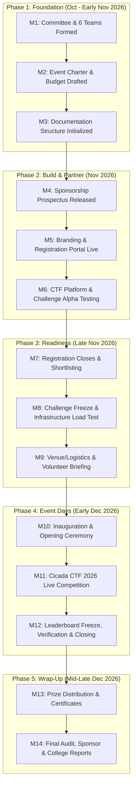

# Timeline and Milestones

## 1. Overview
This section presents the master chronological roadmap for **Cicada CTF 2026**, spanning pre-planning, sponsorship and outreach drives, technical development, participant registration, event execution in early December 2026, and post-event wrap-up.

## 2. Responsible Team and Members
- **Primary Owner:** Logistics Team & Documentation Team
- **Contributors:** All Six Team Leads (Milestone Owners)
> ⚠️ TBD: Assign overall schedule controller from Logistics/Documentation Team | Owner: Logistics Team | Due: 2026-11-08

## 3. Timeline
| Phase | Window | Status |
| :--- | :--- | :--- |
| **Phase 1: Planning & Committee Formation** | October – Early November 2026 (`TBD`) | In Progress |
| **Phase 2: Sponsorship, Branding & Platform Setup** | November 2026 (`TBD`) | Pending |
| **Phase 3: Registration, Outreach & Challenge Freeze** | Mid–Late November 2026 (`TBD`) | Pending |
| **Phase 4: Main Event Execution** | Early December 2026 (`Exact Dates: TBD`) | Planned |
| **Phase 5: Post-Event Evaluation & Reporting** | Mid–Late December 2026 (`TBD`) | Planned |

## 4. Detailed Description
### 4.1 Master Event Roadmap Diagram

### 4.2 Cross-Team Milestone Tracker

| Milestone ID | Milestone Description | Owner Team | Planned Date | Actual Date | Status |
| :--- | :--- | :--- | :--- | :--- | :--- |
| `MS-01` | Core Committee & 6 Teams Finalized | All Teams | `TBD` | `TBD` | Pending |
| `MS-02` | Sponsorship Brochure & Tiers Finalized | Sponsorship + PR & Design | `TBD` | `TBD` | Pending |
| `MS-03` | Official Event Dates & Venue Confirmed | Logistics | `TBD` | `TBD` | Pending |
| `MS-04` | Registration Portal Opened | Development + Outreach | `TBD` | `TBD` | Pending |
| `MS-05` | Challenge Set Alpha Freeze | Development | `TBD` | `TBD` | Pending |
| `MS-06` | Challenge Set Final Freeze & QA Sign-Off | Development | `TBD` | `TBD` | Pending |
| `MS-07` | Registration Deadline & Team Shortlisting | Outreach + Development | `TBD` | `TBD` | Pending |
| `MS-08` | Infrastructure Stress Testing Complete | Development | `TBD` | `TBD` | Pending |
| `MS-09` | Cicada CTF 2026 Kickoff (Day 1) | All Teams | Early Dec 2026 (`TBD`) | `TBD` | Planned |
| `MS-10` | Competition Conclusion & Winner Announcement | All Teams | Early Dec 2026 (`TBD`) | `TBD` | Planned |
| `MS-11` | Final Documentation & Financial Closure | Documentation + Sponsorship | `TBD` | `TBD` | Planned |

## 5. Decisions Made and Why
> ⚠️ TBD: Record any milestone buffer adjustments or deadline extensions approved by the committee | Owner: Logistics Team | Due: Ongoing

## 6. Challenges Faced and How They Were Solved
> ⚠️ TBD: Document any schedule compression issues (e.g., exam schedules, vendor delays) and mitigation actions | Owner: Logistics Team | Due: Post-Event

## 7. Outcomes and Metrics
- **Milestones Completed On Time (%):** `TBD`
- **Schedule Variance (Days):** `TBD`

## 8. Photo/Media Section

*Figure 1.2: Organizing Leads Reviewing the Master Timeline and Milestones | Date: TBD | Photo credit: TBD*

## 9. Lessons Learned
> ⚠️ TBD: Document insights on lead times required for sponsorships, challenge authoring, and college permissions | Owner: Logistics Team & Documentation Team | Due: Post-Event

## 10. Open Items / TBD
> ⚠️ TBD: Populate exact target dates for Milestones MS-01 through MS-11 | Owner: All Team Leads | Due: 2026-11-10
