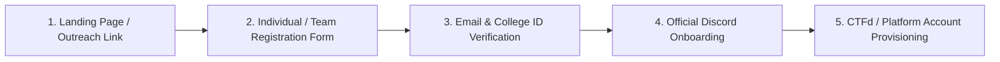

# Registration and Eligibility

## 1. Overview
This section documents the participant registration process, portal configuration, eligibility criteria, verification workflows, and registration timeline for **Cicada CTF 2026**.

## 2. Responsible Team and Members
- **Primary Owner:** Outreach Team
- **Contributors:** Development Team (Registration Portal Integration), Core Committee (Eligibility Policy)
> ⚠️ TBD: Assign Registration Portal Coordinator from Outreach/Development Team | Owner: Outreach Team | Due: 2026-11-08

## 3. Timeline
| Milestone | Target Date | Status |
| :--- | :--- | :--- |
| Registration Platform Selection & Setup | `TBD` | Pending |
| Registration Opens | `TBD` | Pending |
| Registration Closes | `TBD (Late Nov 2026)` | Pending |
| Eligibility Verification & Credential Issuance | `TBD (Late Nov 2026)` | Pending |

## 4. Detailed Description
### 4.1 Eligibility Criteria
- **Target Demographic:** `TBD (e.g., Undergraduate and Postgraduate students across Indian universities / Open category / BIT Mesra internal track)`
- **Institutional ID Requirement:** Participants must provide valid college/university identification (`TBD`).
- **Registration Fee:** `TBD (Free / Paid — specify amount if applicable)`

### 4.2 Registration Platform & Workflow
- **Platform Used:** `TBD (Unstop / Devfolio / Custom Portal / CTFd Direct Registration)`
- **Information Collected (Privacy Compliant):**
  - Team Name & Team Captain Designation
  - Participant Full Name, Institution/College Name, Year of Study, Branch/Degree
  - Official Email & Discord Handle *(Stored only in restricted internal database, never in public docs)*

## 5. Decisions Made and Why
> ⚠️ TBD: Document rationale for choosing the registration platform and deciding whether non-student/open teams are eligible for prizes | Owner: Outreach Team & Core Committee | Due: 2026-11-12

## 6. Challenges Faced and How They Were Solved
> ⚠️ TBD: Document issues such as duplicate team entries, invalid student IDs, or last-minute registration surges | Owner: Outreach Team | Due: Post-Event

## 7. Outcomes and Metrics
| Metric | Count |
| :--- | :--- |
| Total Portal Views / Impressions | `TBD` |
| Total Individual Registrations | `TBD` |
| Total Complete Team Registrations | `TBD` |
| Total Verified Eligible Teams | `TBD` |
| Participating Colleges Represented | `TBD` |
| BIT Mesra Internal Teams vs. External Teams | `TBD` |

## 8. Photo/Media Section

*Figure 3.1: Cicada CTF 2026 Registration Portal Interface | Date: TBD | Photo credit: TBD*

## 9. Lessons Learned
> ⚠️ TBD: Record lessons learned on form design, automated ID verification, and reminder cadences | Owner: Outreach Team | Due: Post-Event

## 10. Open Items / TBD
> ⚠️ TBD: Confirm registration opening and closing dates | Owner: Outreach Team | Due: 2026-11-10
> ⚠️ TBD: Confirm exact eligibility rules (inter-college vs. intra-college, UG/PG restrictions, registration fee) | Owner: Core Committee | Due: 2026-11-10
