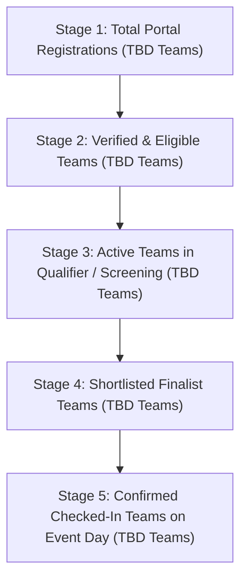

# Selection and Shortlisting

## 1. Overview
This section documents the participant selection pipeline, qualifier round structure (if applicable), shortlisting criteria, waitlist policies, and final confirmed team statistics for **Cicada CTF 2026**.

## 2. Responsible Team and Members
- **Primary Owner:** Development Team & Outreach Team
- **Contributors:** Logistics Team (Venue Capacity Alignment)
> ⚠️ TBD: Assign Shortlisting & Verification Lead | Owner: Development Team & Outreach Team | Due: 2026-11-10

## 3. Timeline
| Milestone | Target Date | Status |
| :--- | :--- | :--- |
| Selection Criteria Published | `TBD` | Pending |
| Online Qualifier / Screening Round *(if applicable)* | `TBD` | Pending |
| Shortlisted Teams Announced | `TBD` | Pending |
| Final Attendance / RSVP Confirmation Deadline | `TBD` | Pending |

## 4. Detailed Description
### 4.1 Selection Model
> ⚠️ TBD: Confirm whether Cicada CTF 2026 uses a single-stage open competition, a two-stage (Online Qualifier → Offline/Main Finals) model, or direct verification shortlisting | Owner: Core Committee & Development Team | Due: 2026-11-12

- **Round 1 / Registration Screening:** `TBD`
- **Qualifier Round Criteria (if applicable):**
  - Top `N` teams overall: `TBD`
  - Reserved quota for BIT Mesra / Beginner teams *(if applicable)*: `TBD`
  - Mandatory write-up verification prior to finalist confirmation: `TBD`

### 4.2 Registration & Selection Funnel Diagram

### 4.3 Final Shortlisted Teams Summary Table
*(Note: Only public Team Names, Institutions, and Ranks/Categories are listed here. Personal contact details are kept in the internal appendix.)*

| S.No. | Team Name | Institution / College | Track / Category | Qualifier Rank / Status | RSVP Confirmed |
| :--- | :--- | :--- | :--- | :--- | :--- |
| 1 | `TBD` | `TBD` | `TBD` | `TBD` | `TBD` |
| 2 | `TBD` | `TBD` | `TBD` | `TBD` | `TBD` |
| 3 | `TBD` | `TBD` | `TBD` | `TBD` | `TBD` |

## 5. Decisions Made and Why
> ⚠️ TBD: Record decisions on finalist cutoffs, waitlist promotion rules, and write-up verification gates | Owner: Development Team & Outreach Team | Due: 2026-11-25

## 6. Challenges Faced and How They Were Solved
> ⚠️ TBD: Document how no-shows, tie-breakers, or disqualified teams were replaced from the waitlist | Owner: Outreach Team | Due: Post-Event

## 7. Outcomes and Metrics
| Funnel Stage | Teams Count | Participants Count | Conversion Rate (%) |
| :--- | :--- | :--- | :--- |
| Registered | `TBD` | `TBD` | 100% |
| Verified Eligible | `TBD` | `TBD` | `TBD` |
| Participated / Active (≥1 solve) | `TBD` | `TBD` | `TBD` |
| Shortlisted for Finals *(if multi-round)* | `TBD` | `TBD` | `TBD` |
| Checked-In for Main Event | `TBD` | `TBD` | `TBD` |

## 8. Photo/Media Section

*Figure 3.3: Registration Funnel and Shortlisting Breakdown for Cicada CTF 2026 | Date: TBD | Photo credit: TBD*

## 9. Lessons Learned
> ⚠️ TBD: Summarize learnings on conversion drop-offs between registration, qualifier, and main event check-in | Owner: Outreach Team | Due: Post-Event

## 10. Open Items / TBD
> ⚠️ TBD: Confirm whether a Qualifier round will be held and its exact date/duration | Owner: Development Team | Due: 2026-11-12
> ⚠️ TBD: Populate final shortlisted team roster upon completion of shortlisting | Owner: Outreach Team | Due: Pre-Event
