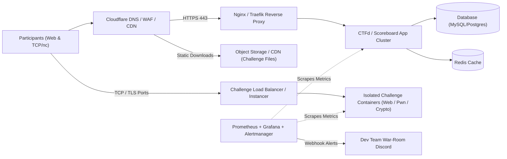

# Platform and Infrastructure

## 1. Overview
This section documents the complete technical architecture, hosting environment, container orchestration, networking, scaling strategy, and observability stack powering **Cicada CTF 2026**.

## 2. Responsible Team and Members
- **Primary Owner:** Development Team (DevOps & Infrastructure Track)
> ⚠️ TBD: List DevOps & Cloud Infrastructure Engineers from the Development Team | Owner: Development Team | Due: 2026-11-08

## 3. Timeline
| Milestone | Target Date | Status |
| :--- | :--- | :--- |
| Cloud Provider & Architecture Selection | `TBD` | Pending |
| Staging Environment Deployment | `TBD (Mid Nov 2026)` | Pending |
| Load Testing & Failover Drill | `TBD (Late Nov 2026)` | Pending |
| Production Cutover & DNS Lock | `TBD (T-48 Hours)` | Planned |
| Post-Event Backup & Server Teardown | `TBD (Post-Event)` | Planned |

## 4. Detailed Description
### 4.1 Platform Stack Overview
| Component | Technology Choice | Specification / Sizing | Purpose |
| :--- | :--- | :--- | :--- |
| **Core CTF Scoreboard** | `TBD (CTFd / rCTF / Custom)` | `TBD (vCPU / RAM)` | User auth, scoreboard, flag validation |
| **Database Layer** | `TBD (PostgreSQL / MariaDB + Redis)` | `TBD` | Persistent state, session & scoreboard caching |
| **Challenge Hosting** | `TBD (Docker / Kubernetes / kCTF / Chall-Manager)` | `TBD (Nodes / vCPU / RAM)` | Isolated challenge execution & per-team instances |
| **Reverse Proxy & WAF** | `TBD (Cloudflare + Nginx / Traefik)` | `TBD` | TLS termination, DDoS protection, rate limiting |
| **Artifact Storage** | `TBD (S3 / Cloudflare R2 / CDN)` | `TBD` | Hosting static challenge binaries, PCAPs, archives |
| **Monitoring & Logs** | `TBD (Prometheus + Grafana + Loki)` | `TBD` | Real-time CPU/RAM/network telemetry & audit logs |

### 4.2 Infrastructure Architecture Diagram

### 4.3 Sandboxing & Resource Limits
- **Container Hardening:** Read-only root filesystems where possible, dropped Linux capabilities (`CAP_Drop: ALL`), `nsjail` / `xinetd` / `redpwn/jail` for Pwn challenges.
- **Per-Container Limits:** CPU quota (`TBD`), Memory limit (`TBD`), PIDs limit (`TBD`) to prevent fork bombs.

## 5. Decisions Made and Why
> ⚠️ TBD: Document why the specific CTF platform, cloud provider, and container orchestration system were chosen | Owner: Development Team | Due: 2026-11-15

## 6. Challenges Faced and How They Were Solved
> ⚠️ TBD: Document any infrastructure bottlenecks during load testing or live traffic spikes and how scaling was handled | Owner: Development Team | Due: Post-Event

## 7. Outcomes and Metrics
| Infrastructure Metric | Target | Actual (Post-Event) |
| :--- | :--- | :--- |
| Scoreboard Uptime (%) | ≥ 99.9% | `TBD` |
| Peak Requests per Second (RPS) | `TBD` | `TBD` |
| Total Container Instances Spawned | `TBD` | `TBD` |
| Total Bandwidth Served (GB/TB) | `TBD` | `TBD` |
| Total Cloud Hosting Cost (INR/USD) | `TBD` | `TBD` |

## 8. Photo/Media Section

*Figure 4.2: Live Infrastructure Monitoring Dashboard (Grafana/Prometheus) During Cicada CTF 2026 | Date: TBD | Photo credit: TBD*

## 9. Lessons Learned
> ⚠️ TBD: Record infrastructure sizing, caching, and container isolation takeaways for future editions | Owner: Development Team | Due: Post-Event

## 10. Open Items / TBD
> ⚠️ TBD: Confirm CTF platform software, cloud hosting provider, VM specs, and domain name | Owner: Development Team | Due: 2026-11-12
