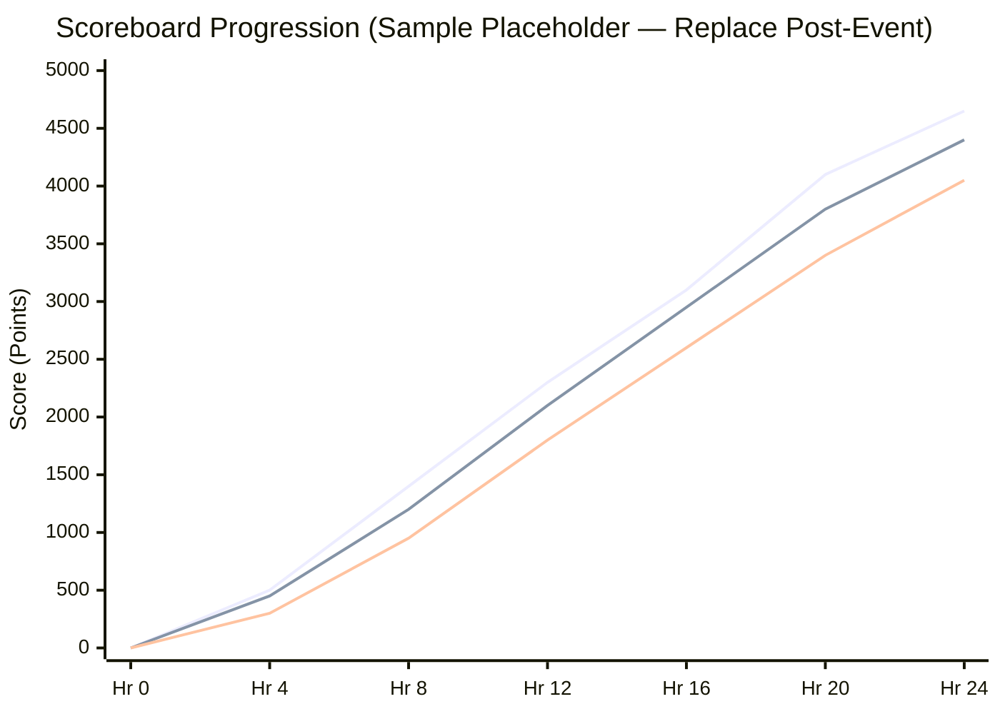

# Scoring and Leaderboard

## 1. Overview
This section documents the scoring mechanism (dynamic vs. static scoring), mathematical decay parameters, first-blood bonuses, scoreboard freeze policy, and leaderboard progression during **Cicada CTF 2026**.

## 2. Responsible Team and Members
- **Primary Owner:** Development Team
> ⚠️ TBD: Assign Scoring & Leaderboard Administrator from Development Team | Owner: Development Team | Due: 2026-11-10

## 3. Timeline
| Milestone | Target Date | Status |
| :--- | :--- | :--- |
| Scoring Formula & Decay Curve Selection | `TBD` | Pending |
| Scoreboard Configuration & Test Simulation | `TBD (Late Nov 2026)` | Pending |
| Live Leaderboard Freeze *(if applicable)* | `TBD (Early Dec 2026)` | Planned |
| Post-Audit Final Leaderboard Publication | `TBD (Early Dec 2026)` | Planned |

## 4. Detailed Description
### 4.1 Scoring Mechanism
- **Scoring Model:** `TBD (Dynamic Logarithmic / Parabolic Decay vs. Static Tiered Points)`
- **Initial Challenge Value (\(V_{\text{max}}\)):** `TBD (e.g., 500 points)`
- **Minimum Challenge Value (\(V_{\text{min}}\)):** `TBD (e.g., 50 or 100 points)`
- **Decay Threshold (\(S_{\text{decay}}\) solves to reach minimum):** `TBD (e.g., 30 or 50 solves)`
- **First Blood Bonus:** `TBD (None / +X% bonus / Special Award)`

Standard CTFd Parabolic Dynamic Scoring Formula (reference model, subject to confirmation):
$$
V = \max\left(V_{\min}, \left\lceil \frac{V_{\min} - V_{\max}}{S_{\text{decay}}^2} \cdot s^2 + V_{\max} \right\rceil\right)
$$
where $s$ is the number of valid solves on the challenge.

### 4.2 Scoreboard Freeze & Verification Policy
- **Scoreboard Freeze Window:** `TBD (e.g., Final 1 hour of competition / No freeze)`
- **Audit Window:** Following competition end, the leaderboard enters a verification state while the Development Team audits flag submission telemetry and winner write-ups.

### 4.3 Scoreboard Progression Placeholder (Top 10 Teams Over Time)
> ⚠️ TBD: Replace placeholder values in the chart below with actual hourly point totals of the Top 5–10 teams after the competition | Owner: Development Team & Documentation Team | Due: Post-Event

## 5. Decisions Made and Why
> ⚠️ TBD: Document rationale for choosing the decay threshold $S_{\text{decay}}$ based on expected active team count | Owner: Development Team | Due: 2026-11-18

## 6. Challenges Faced and How They Were Solved
> ⚠️ TBD: Document any point recalculation lags, cache invalidation issues, or tie-break edge cases | Owner: Development Team | Due: Post-Event

## 7. Outcomes and Metrics
- **Total Valid Flag Submissions:** `TBD`
- **Total Incorrect Flag Submissions:** `TBD`
- **Highest Score Achieved:** `TBD`
- **Median Score of Active Teams:** `TBD`

## 8. Photo/Media Section

*Figure 4.4: Live Scoreboard Progression and Final Standings Screen | Date: TBD | Photo credit: TBD*

## 9. Lessons Learned
> ⚠️ TBD: Record observations on how dynamic scoring parameters impacted competition pacing | Owner: Development Team | Due: Post-Event

## 10. Open Items / TBD
> ⚠️ TBD: Confirm exact $V_{\max}$, $V_{\min}$, $S_{\text{decay}}$, first-blood bonus, and scoreboard freeze policy | Owner: Development Team | Due: 2026-11-15
