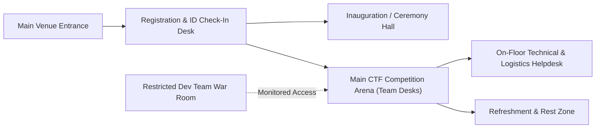

# Venue and Setup

## 1. Overview
This section documents the venue selection, hall bookings, floor plans, seating capacities, stage setup, registration desk layout, and technical war-room arrangement for **Cicada CTF 2026** (applicable to Offline or Hybrid execution, or central command center setup for Online execution).

## 2. Responsible Team and Members
- **Primary Owner:** Logistics Team
- **Contributors:** Development Team (War-Room Setup), PR & Design Team (Signage & Branding Placement)
> ⚠️ TBD: Assign Venue Manager from Logistics Team | Owner: Logistics Team | Due: 2026-11-08

## 3. Timeline
| Milestone | Target Date | Status |
| :--- | :--- | :--- |
| Venue Inspection & Selection at BIT Mesra | `TBD` | Pending |
| Official Hall Booking & Night-Access Approval | `TBD (Mid Nov 2026)` | Pending |
| Floor Plan & Seating Layout Finalization | `TBD (Late Nov 2026)` | Pending |
| Physical Setup, Branding & Dry Run (T-1 Day) | `TBD (Early Dec 2026)` | Planned |
| Post-Event Venue Teardown & Handover | `TBD (Early Dec 2026)` | Planned |

## 4. Detailed Description
### 4.1 Venue Allocation Matrix
| Zone / Function | Building / Room Name (BIT Mesra) | Capacity (Persons) | Access Level | Purpose |
| :--- | :--- | :--- | :--- | :--- |
| **Inauguration & Closing Hall** | `TBD (e.g., CAT Hall / GP Birla Auditorium / Seminar Hall)` | `TBD` | All Participants & Guests | Ceremonies, Keynotes, Prize Distribution |
| **Main Competition Arena** | `TBD (e.g., Central Computer Lab / R&D Building / RnD Hall)` | `TBD` | Verified Participants & Proctors | Live CTF Competition Seating |
| **Registration & Helpdesk Foyer** | `TBD` | `TBD` | Public / Check-in | ID verification, kit distribution |
| **Technical War Room (Admin Only)** | `TBD` | `TBD` | Restricted (Dev Team & Core) | Server monitoring, challenge debugging, anti-cheat |
| **Dining / Refreshment Zone** | `TBD` | `TBD` | Participants & Volunteers | Meals, coffee/tea breaks |

### 4.2 Venue Layout & Traffic Flow Diagram

## 5. Decisions Made and Why
> ⚠️ TBD: Record why the specific campus venue/halls were chosen (capacity, power availability, overnight accessibility, network stability) | Owner: Logistics Team | Due: 2026-11-15

## 6. Challenges Faced and How They Were Solved
> ⚠️ TBD: Document any venue constraints (e.g., overnight lockup policies, AC/heating, seating extensions) and how they were resolved | Owner: Logistics Team | Due: Post-Event

## 7. Outcomes and Metrics
- **Total Floor Capacity Provisioned:** `TBD`
- **Total Team Desks Set Up:** `TBD`
- **Venue Setup Completion Time:** `TBD`

## 8. Photo/Media Section

*Figure 6.1: Main Competition Venue, Team Seating Layout, and Stage Setup at BIT Mesra | Date: TBD | Photo credit: TBD*

## 9. Lessons Learned
> ⚠️ TBD: Document recommendations on hall booking lead times and floor layout ergonomics | Owner: Logistics Team | Due: Post-Event

## 10. Open Items / TBD
> ⚠️ TBD: Confirm exact competition mode (Online/Offline/Hybrid) and exact building/hall names at BIT Mesra | Owner: Logistics Team | Due: 2026-11-10
