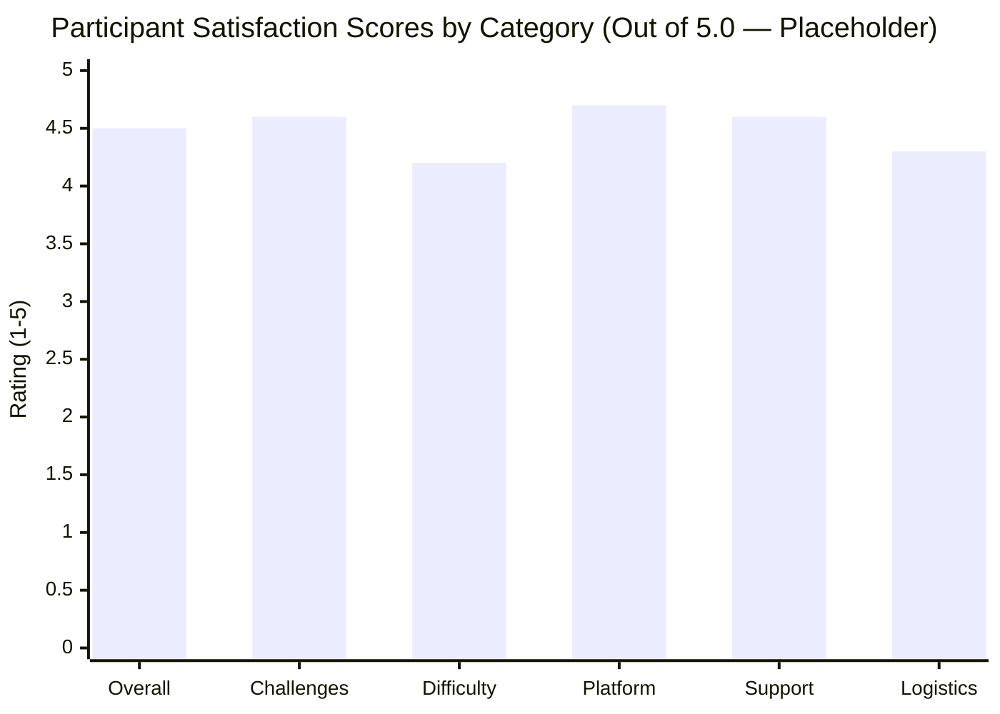

# Feedback Analysis

## 1. Overview
This section presents the quantitative and qualitative analysis of post-event feedback collected from participants, student volunteers, and sponsors of **Cicada CTF 2026**, using the standardized [Post-Event Feedback Form](../10-appendices/templates/post-event-feedback-form.md).

## 2. Responsible Team and Members
- **Primary Owner:** Outreach Team & Documentation Team
> ⚠️ TBD: Assign Survey & Data Analytics Lead from Outreach/Documentation Team | Owner: Documentation Team | Due: 2026-11-20

## 3. Timeline
| Milestone | Target Date | Status |
| :--- | :--- | :--- |
| Feedback Form Finalization | 2026-11-01 | Completed (Template Ready) |
| Survey Distribution at Competition Close | `TBD (Early Dec 2026)` | Planned |
| Survey Closure & Statistical Aggregation | `TBD (T+5 Days)` | Planned |
| Insights Integrated into Recommendations | `TBD (Mid Dec 2026)` | Planned |

## 4. Detailed Description
### 4.1 Quantitative Ratings Summary (1.0 to 5.0 Scale)
| Evaluation Dimension | Target Score | Actual Mean Score (`/ 5.0`) | Median Score | Response Count (`N`) |
| :--- | :--- | :--- | :--- | :--- |
| **Overall Event Experience** | $\ge 4.3$ | `TBD` | `TBD` | `TBD` |
| **Challenge Quality & Creativity** | $\ge 4.3$ | `TBD` | `TBD` | `TBD` |
| **Difficulty Balance Across Categories** | $\ge 4.0$ | `TBD` | `TBD` | `TBD` |
| **Platform Stability & Speed** | $\ge 4.5$ | `TBD` | `TBD` | `TBD` |
| **Communication & Support Desk Responsiveness** | $\ge 4.4$ | `TBD` | `TBD` | `TBD` |
| **Venue, Food & Logistics *(if Offline/Hybrid)*** | $\ge 4.2$ | `TBD` | `TBD` | `TBD` |
| **Net Promoter Score (NPS) / Would Participate Again (%)** | $\ge 85\%$ | `TBD` | — | `TBD` |

### 4.2 Participant Rating Distribution Placeholder Chart
> ⚠️ TBD: Replace sample placeholder numbers below with actual survey data post-event | Owner: Documentation Team | Due: Post-Event

### 4.3 Qualitative Feedback Highlights
- **Most Appreciated Aspects:** `TBD`
- **Most Enjoyed Challenge(s) Voted by Players:** `TBD`
- **Constructive Criticism / Areas for Improvement:** `TBD`
- **Sponsor & Partner Testimonials:** `TBD`

## 5. Decisions Made and Why
- **Decision:** Link participation certificate download/issuance to completion of the short post-event feedback form.
- **Rationale:** Ensures a high survey response rate ($\ge 70\%$) rather than a biased self-selected sample.

## 6. Challenges Faced and How They Were Solved
> ⚠️ TBD: Document any survey collection challenges | Owner: Outreach Team | Due: Post-Event

## 7. Outcomes and Metrics
- **Total Participant Responses Collected:** `TBD` (`Response Rate: TBD%`)
- **Total Volunteer Responses Collected:** `TBD`
- **Total Sponsor Feedback Responses Collected:** `TBD`

## 8. Photo/Media Section

*Figure 8.3: Participant Satisfaction and Category Rating Breakdown | Date: TBD | Photo credit: TBD*

## 9. Lessons Learned
> ⚠️ TBD: Synthesize key lessons directly voiced by participants and sponsors | Owner: Documentation Team | Due: Post-Event

## 10. Open Items / TBD
> ⚠️ TBD: Populate actual survey metrics and verbatim testimonials after survey closure in December 2026 | Owner: Outreach Team & Documentation Team | Due: Mid Dec 2026
