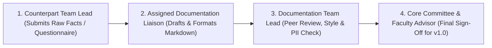

# Documentation Workflow Plan

## 1. Overview
This plan defines the operational workflow for how the **Documentation Team** collects, verifies, reviews, and publishes inputs from all six organizing teams of **Cicada CTF 2026** before, during, and after the event.

---

## 2. Roles & Approval Hierarchy (RACI Model)

| Role | Assigned To | Responsibilities |
| :--- | :--- | :--- |
| **Input Providers** | Leads of Logistics, PR & Design, Sponsorship, Outreach, Development | Complete intake questionnaires, share raw sheets/logs, verify technical accuracy of their sections. |
| **Section Authors (Liaisons)** | Documentation Team Members | Interview assigned team leads weekly, convert raw inputs into standardized 10-part Markdown sections, update the TBD tracker. |
| **Managing Editor / Reviewer** | Documentation Team Lead | Audit all PRs/edits against the [Documentation Style Guide](documentation-style-guide.md), verify zero PII leakage, and run link/build checks. |
| **Approving Authority** | IEEE Student Branch Chair & BIT Mesra Faculty Coordinator | Approve pre-event rulebooks and sign off on the final post-event Stakeholder & College Reports. |

---

## 3. Dedicated Liaison Mapping

| Documentation Liaison Role | Counterpart Team(s) Covered | Primary Repository Sections Owned |
| :--- | :--- | :--- |
| **Liaison A (Technical Writer)** | Development Team | `04-technical/*`, `08.1 Final Results` |
| **Liaison B (Operations Writer)** | Logistics Team | `06-logistics/*`, `07-event-days/*` |
| **Liaison C (External Relations Writer)** | Sponsorship, Outreach & PR Teams | `03-participant-lifecycle/*`, `05-outreach-pr-sponsorship/*`, `08.2–08.4` |
| **Liaison D (Media & Governance Editor)** | PR & Design (Photographers) + Core | `00-front-matter/*`, `01-planning/*`, `02-teams/*`, `09-media/*`, `10-appendices/*` |

---

## 4. Weekly Update Cadence (Pre-Event)
Every week leading up to **Cicada CTF 2026** follows a fixed 4-step cycle:
1. **Friday (`18:00 IST`) — TBD Reminder:** Documentation Liaisons send their counterpart Team Leads the list of `TBD` items due in the coming week from [missing-information-tracker.md](../missing-information-tracker.md).
2. **Sunday (`All Day`) — Weekly Sync & Minute Capture:** Documentation Scribe records minutes at the weekly Core Committee meeting (`01-planning-and-preparation/meeting-minutes/`) and collects completed questionnaire updates.
3. **Tuesday (`21:00 IST`) — Markdown Drafting:** Liaisons update their assigned `.md` files, replace resolved `TBD` callouts with confirmed facts, and mark those IDs `🟢 Resolved` in the tracker.
4. **Wednesday (`21:00 IST`) — Quality & Build Check:** Documentation Team Lead reviews changes and runs `./scripts/build-docs.ps1 -Target verify` to confirm zero broken links or formatting errors.

---

## 5. Live Event-Day Workflow (Early December 2026)
During the competition, the Documentation Team shifts from weekly batch updates to **real-time shift logging**:
- **Shift Rotation:** At least one Documentation Scribe is on duty in the Command Center / War Room during every shift (`Shift S1` through `Shift S4`).
- **Hourly Checkpoints:** At the top of every hour (`XX:00`), the on-duty scribe records active team counts, total solves, wave releases, and venue status in [07.1 Day-Wise Report](../../07-event-days/day-wise-report.md).
- **Real-Time Incident Capture:** Any technical bug (`TECH-XX`) or operational incident (`INC-XXX`) is logged immediately using the [Incident Report Template](../templates/incident-report-template.md).
- **Photo Sync:** At the end of each shift, photographers hand over SD card selects to the Media Archivist to rename and file into `09-media/photos/event-days/`.

---

## 6. Post-Event Closure Workflow (T+1 to T+10 Days)
- **`T + 1 Day`:** Lock final verified leaderboard (`08.1`), archive challenge catalog (`04.3`), and send out the [Post-Event Feedback Form](../templates/post-event-feedback-form.md).
- **`T + 4 Days`:** Hold the 6-team retrospective meeting to populate `08.5 Lessons Learned` and `08.6 Recommendations`.
- **`T + 7 Days`:** Complete financial reconciliation (`08.4`) and feedback analysis (`08.3`); resolve all remaining `TBD` items.
- **`T + 10 Days`:** Generate final `v1.0.0` PDF, DOCX, and static website builds; submit signed copies to BIT Mesra, IEEE, and Sponsors.
